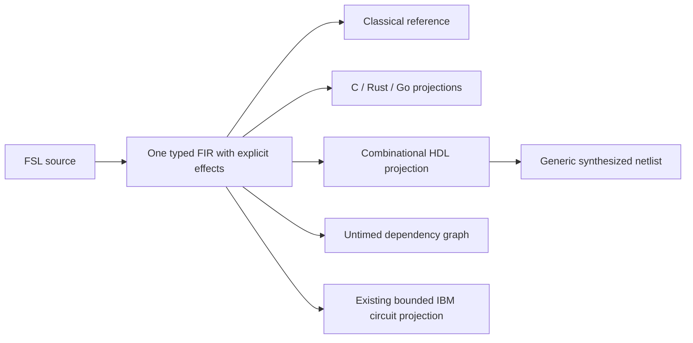

# Eight additional computational research axes

This extends the research scope, not the list of supported production devices.
The first experiment is [initial fabric slices](../experiments/fabric/initial-slices/README.md).
The single semantic owner is still `fission_fsl::CompiledInstruction` with its
one value/op table. A Verilog file, dependency graph, source wrapper or target
placement record is a projection, not another canonical IR.

## What was added first

| Axis | Initial authored function / projection | What this does not implement |
|---|---|---|
| FPGA / reconfigurable fabric | Wrapping 8-bit add; native Verilog emission; RTL and generic-netlist simulation | Device resources, timing closure, board constraints, bitstream or board run |
| DSP | Unsigned 8-bit saturating add, expressed with widening and explicit masks | DSP ISA decoding, implicit accumulator/rounding/flag rules or ABI |
| NPU / TPU | Two-element unsigned dot product, elaborated into typed scalar FIR | First-class tensors/strides, quantization policies, accelerator ISA or runtime |
| ASIC | Wrapping 16-bit multiply-accumulate; generic synthesis | Standard cells, PDK, physical design, area/power/timing result or fabrication |
| Neuromorphic | One discrete LIF transition with explicit old/new state and spike output | Continuous LIF, refractory periods, delayed/asynchronous events or chip support |
| PIM / near-memory | XOR of two caller-supplied words; an explicit same-bank placement hypothesis | A memory transaction, row command, bank atomicity/coherence model or PIM execution |
| Analog | Unsigned Q8.8 forward-Euler RC step with declared timestep/time constant and floor rounding | Continuous-time FIR, a SPICE circuit, device nonidealities or analog hardware |
| Dataflow / CGRA | Fork/join arithmetic dependencies over the same FIR; DOT view | Token firing, stream rates/backpressure, PE scheduling/routing or CGRA execution |

The scalar elaboration, placement hypothesis and discrete approximation labels
are deliberate. A fixed two-element dot product does not establish a tensor
semantic domain. A word XOR does not establish in-memory semantics. An Euler
step does not establish continuous dynamics. These remain explicit gaps.

FPGA and ASIC reuse a digital logic projection, but their physical design flows
are separate. A generic gate count is neither a target LUT count nor silicon
area. The experiment does not assume one substrate is a completed successor of
another.

## Canonical numerical additions

FSLC v15 adds three generic operations to the existing `IntBinaryOp` owner:

- `uN.mul.wrap` / `iN.mul.wrap`: low N bits of the product, 1..64 bits.
- `uN.shl`: zero result for a count at least N; otherwise low N shifted bits.
- `uN.lshr`: zero result for a count at least N; otherwise unsigned right shift.

Operands and result have the same width/type. Shift counts are the unsigned
bit-vector value, not a host-language masked shift count. Signed logical shifts
refuse in this initial contract. C and Rust projections explicitly guard the
host width; reference execution and HDL apply the declared guest width. Go uses
unsigned slot storage and its defined large-count shift behavior. New operations
require v15; older source still selects its previous package version and older
encoded bytes remain readable. No opcode identity or hardware vendor controls
these generic rules.

The existing stack/control reference and C/Rust consumers now also admit the
canonical binary operations. This closes a prior consumer gap; it does not add a
parallel arithmetic evaluator. Cranelift native lifting and unrelated GPU
projections continue to refuse their unsupported operation sets.

## HDL boundary

`FabricPlan` borrows a validated body. The current projection admits implicit
straight-line bodies with up to 512 ops / 256 values, 1..64-bit values, at most
16 input slots and 1..16 outputs. It refuses explicit blocks, registers/flags,
byte memory, guest PC, lane state, quantum effects and unsupported semantics.
Input and output ports are unsigned 64-bit slots in bottom-to-top stack order;
FIR pops mask their declared widths. Internal wires retain each value's width.
Signed conversions and comparisons use explicit signed views of those wires.
All stack operations are resolved to port/value aliases; the generated logic
contains no host stack or interpreter.

This is a two-valued combinational function. There is no clock, latency,
ready/valid handshake, metastability, X/Z or physical propagation-time contract.
A simulator delay used to observe settled testbench signals is not a hardware
latency assertion. The dependency graph preserves canonical value IDs/op indices
but is not a new executable IR or a timing schedule.

## Future domain contracts before broad target support

All future operations must remain in the same FIR owner and carry their domain
preconditions, effects and provenance. The following cannot be inferred from
scalar output code:

- Tensor: shape, storage/layout, quantization scales/zero points, accumulation and
  reduction order, overflow/rounding and numerical tolerances.
- DSP: fixed-point formats, accumulator widths, saturation modes, lane packing,
  flags and circular/streaming memory effects.
- Fabric/ASIC: state registers, reset/clock domains, cycles, memory ports,
  interfaces, resources and target-specific constraints.
- Neuromorphic: time units, spike identity/order, event queues/delays,
  refractory/reset policy and stochastic effects.
- Analog: units, differential/algebraic relations, initial conditions,
  integration/tolerance/stability contracts and separate approximation evidence.
- PIM: explicit memory effects, bank/row/word identities, atomicity, coherence,
  placement and physical command semantics.
- Dataflow/CGRA: tokens, rates, buffering/backpressure, firing rules,
  communication and a validated mapping/schedule.

A new domain is not admitted merely by giving a scalar profile a domain name.
Binary/input frontends and output backends remain separate tasks. Device binary
recovery, round-trip device code generation and execution each need their own
measurements. The initial fixtures establish none of these broad capabilities.

## Primary references

- [Icarus compiler/runtime workflow](https://steveicarus.github.io/iverilog/usage/getting_started.html)
- [Yosys synthesis framework](https://yosyshq.readthedocs.io/projects/yosys/en/latest/)
- [YoWASP packaging](https://yowasp.org/) — external experimental tool environment, not a core dependency.
- [MLIR Linalg](https://mlir.llvm.org/docs/Dialects/Linalg/) — structured linear-algebra contracts to study; not a dependency.
- [CIRCT Handshake](https://circt.llvm.org/docs/Dialects/Handshake/) — richer dataflow/channel semantics than the initial untimed DAG.
- [NEST continuous LIF model](https://nest-simulator.readthedocs.io/en/stable/models/iaf_psc_delta.html) — reference for future domain requirements, not the authored discrete fixture's oracle.
- [Ambit paper](https://www.microsoft.com/en-us/research/wp-content/uploads/2017/09/MICRO-50_347.pdf) — physical in-DRAM operations to distinguish from scalar placement metadata.
- [ngspice documentation](https://ngspice.sourceforge.io/docs.html) — future continuous circuit/solver investigation; not currently executed.
